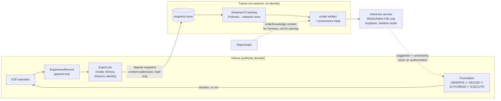

# DreamerV3 as a bounded learning component for Virkora — design proposal V1

```text
STATUS:        DESIGN PROPOSAL. Nothing in this document is implemented.
RUNTIME CLAIM: NONE.
SCOPE:         how DreamerV3 could later serve as a bounded learning and
               simulation component under Virkora/Foundation authority.
DATE:          2026-10-22
PRECONDITION:  not satisfied today (section 1).
```

Written for the owner and for whoever later writes the integration contract. It
proposes a shape and, just as importantly, argues where model-based
reinforcement learning is the wrong tool.

---

## 1. The precondition, stated first

Virkora's own target contract gates this work, and the gate is not open:

- `docs/architecture/VIRKORA_AGENT_ORCHESTRATION_WORLD_MODEL_V1_2.md` section 21
  lists `Fixed eval/learning framework | MISSING | after repeatable E2E
  episodes`. Repeatable end-to-end episodes are Phase I of the master
  completion contract, and the ledger has Phases C-K not started.
- Section 20 requires, before any learned production routing: an
  `ExperienceRecord`, a fixed eval suite, cohort stratification, minimum
  samples, uncertainty estimates, shadow mode, every routing decision logged,
  drift measurement and deterministic rollback. None exist.
- LAW 4: learning may improve routing, prediction, resource planning and
  evaluation, and may never change policy meaning, authority or approval
  requirements.
- LAW 5: Foundation must never evaluate authority from `DERIVED`, `HYPOTHESIS`,
  `PREDICTED` or `DESIRED` state.

So the honest trigger for this design is: **Phase I closed and
`ExperienceRecord` emitted for real episodes.** Until then, this document is a
plan, and DreamerV3 stays a standalone research trainer.

---

## 2. Which direction the data flows

The central design choice is that **DreamerV3 never calls Virkora.** Everything
follows from it.



Why push, not pull: a trainer that pulls needs network access, an OVI workload
identity, a credential and an authorization to read the ledger — four trust
surfaces. A trainer fed a snapshot needs none of them. The export job already
lives inside Virkora, already has an identity, and is already governed. This is
the single largest security simplification available, so it should be the
default and any pull-based variant should have to justify itself.

---

## 3. Boundaries, one by one

### 3.1 Identity and authorization

| Component | Identity | Why |
|---|---|---|
| Export job | Virkora/OVI workload identity | it reads the ledger; it is Virkora's code, under Virkora's governance |
| Trainer | **none** | it reads a file and writes a file; it has no network |
| Inference service | OVI workload identity, READ class only | it is reachable, so it must be identifiable |
| Model artifact | content hash, no identity | data, not a principal |

DreamerV3 must never hold a credential that can authorize an effect, and must
never be able to request one. Under READ / ANALYZE / EFFECT it is **ANALYZE at
most**, permanently.

### 3.2 Foundation's role

Foundation is the only component that may turn a suggestion into an action, and
it must treat model output as `PREDICTED` state — which LAW 5 forbids it from
evaluating authority from. Concretely, a model suggestion may influence only
decisions where the authority question is already settled: which of several
*already authorized* runtimes to use, how many workers to request within an
*already granted* budget, how long to wait before an *already permitted* retry.

It may never influence: whether an effect is allowed, whether approval is
needed, whether identity is trusted, what an effect class is, or whether a
grant is fresh.

### 3.3 No production actions

The trainer has no network namespace reachable from Virkora and no action
space over real systems. In RL terms, its action space is over **simulated**
or **recorded** transitions only. There is no code path from a policy output to
an effect; the only consumer of policy output is a suggestion message that
Foundation is free to ignore.

### 3.4 Isolating training from inference

Two different risk profiles, so two different containers:

| | Training | Inference |
|---|---|---|
| Network | `--network none` | loopback only; `portal` rejects any address containing `://` and defaults to `localhost:{auto}` |
| Input | a frozen snapshot, read-only mount | a request on loopback |
| Output | artifact + metrics | suggestion + uncertainty |
| Lifetime | batch job | long-running, restartable |
| Failure mode | job fails, nothing degrades | suggestions stop; Foundation falls back to its deterministic default |

The fallback requirement is the important one: **every consumer must work
correctly when the model is absent.** If removing the model breaks
orchestration, the model has become authority by the back door.

### 3.5 Resource limits

Training is the greediest workload in the constellation. On a shared host it
needs explicit cgroup limits (`--memory`, `--cpus`, `--pids-limit`), and
preferably its own machine or at least its own Podman machine. The present CPU
wrapper sets no limits — see `DREAMERV3_SECURITY_RECOMMENDATIONS_V1.md`
section 5, which should be closed before any sustained training.

### 3.6 Model artifact versioning

Every artifact binds a reproducibility triple plus its result:

```text
model_version = hash(
    dataset_snapshot_id,   # content hash of the exported ExperienceRecords
    config_hash,           # the full resolved DreamerV3 config
    code_commit)           # this repository's commit
+ eval_result              # scores on the fixed eval suite, with uncertainty
```

Without all three, a model cannot be reproduced or retired with confidence.
Any Virkora decision influenced by a model records `model_version`, which is
what makes section 3.7 possible.

### 3.7 Traceability

Two ledgers, already implied by Virkora's design:

1. **Experiment ledger** (research-side): one row per training run — triple,
   metrics, who started it, why. Answers "where did this model come from".
2. **Decision annotation** (Virkora-side): any decision that consulted a model
   records `model_version` and the suggestion it received, alongside the
   decision it actually made. Answers "did the model influence this, and would
   the decision have differed without it".

The second is what makes shadow mode measurable rather than decorative: run the
model, log its suggestion, ignore it, and compare afterwards.

### 3.8 RepoGraph

RepoGraph belongs in the research loop, not the training loop: it answers
"which code produced this behaviour" and "what else depends on this contract"
for the humans designing the reward and reading the results. Feeding RepoGraph
output into the model as features is possible but should be deferred — it
couples model inputs to code structure, so every refactor becomes a
distribution shift.

### 3.9 External effects

Unchanged and absolute: any effect outside the trainer's own container requires
its own authorization through Foundation. Being able to connect is never a
reason to connect.

---

## 4. Where model-based RL actually fits

This is the part worth arguing, because the default assumption — "we have an
orchestrator, let us learn to orchestrate" — is mostly wrong.

### 4.1 What DreamerV3 needs to be the right tool

| Requirement | Why | Virkora's reality |
|---|---|---|
| Millions of cheap interactions | DreamerV3's data efficiency is good *for deep RL*, which still means 10^5-10^6 steps | a real episode is a real job: seconds to hours. 10^6 episodes is not happening |
| Stationary dynamics | the world model learns transition structure | the orchestrator's code changes weekly; every change is a distribution shift |
| A scalar reward that means something | the objective | "was that orchestration good" is a multi-objective judgement: latency, cost, success, risk |
| Safe exploration | learning needs to try bad actions | trying bad authority or routing decisions on real work is not acceptable |
| High-dimensional observations | where world models beat tabular methods | orchestrator state is small and structured, not pixels |

Four of five point the same way. **On the real orchestrator, DreamerV3 is the
wrong tool.**

### 4.2 The one shape that does fit: simulator-first

The requirements are satisfiable in exactly one configuration: build a
**simulator** of the orchestration domain — a synthetic workload generator with
a queue model, runtime latencies, failure rates and budgets, calibrated against
recorded `ExperienceRecord` data — and train against the simulator, not against
production.

In that configuration DreamerV3 is a reasonable fit for a narrow class:

- **Resource and capacity planning** under uncertain arrival rates.
- **Routing among already-authorized runtimes** when costs and latencies are
  stochastic and correlated over time.
- **Retry and backoff timing** where the cost of waiting trades against the
  cost of failure.
- **Batch and concurrency sizing** under a budget.

All four are sequential, have a measurable scalar objective, and are safe to
explore in simulation. All four also sit entirely inside "already authorized",
so LAW 4 is respected by construction.

The honest cost: the simulator becomes the real engineering project, and the
model is only as good as the simulator's calibration. That is the trade to put
to the owner — not "should we use DreamerV3" but "is a calibrated orchestration
simulator worth building".

### 4.3 What belongs to other tools

| Task | Better tool | Why |
|---|---|---|
| Authority, policy, approval, effect classification | **deterministic code** | required by LAW 4; also simply correct — these are rules, not statistics |
| Idempotency, retries with known semantics, state machines | **deterministic code** | the right answer is specified, not learned |
| Understanding a novel task, code or request; explaining a decision | **LLM agents** | one-shot semantic work with no reward signal and no repetition |
| Predicting job duration or failure probability from tabular features | **gradient boosting** | hundreds to thousands of rows, tabular: boosting beats deep RL and is interpretable |
| Choosing among a few options with measurable outcomes | **contextual bandits** | no long-horizon credit assignment needed; far more sample-efficient, and shadow-mode-friendly |
| Capacity sizing with known arrival and service distributions | **queueing theory / LP** | closed-form or convex; no training, no drift |
| Anomaly and drift detection | **statistics** | well-understood, cheap, auditable |

The pattern: **sequential decisions with delayed consequences and a simulator**
go to RL. **One-shot prediction on small tabular data** goes to boosting or
bandits. **Rules** stay code. **Semantics** goes to LLM agents.

### 4.4 Recommended sequence

1. Close Phase I; emit `ExperienceRecord` for real episodes.
2. Measure the data: episodes per week, variance, how often the dynamics change.
3. Build the baselines first — a boosting model for duration/failure and a
   contextual bandit for a single routing choice, both in shadow mode. They are
   days of work, not months.
4. Only if those baselines show a *sequential* gap worth chasing, and only with
   a calibrated simulator, bring in DreamerV3.

Step 3 is the recommendation. It is cheap, it is safe, it produces the
`ExperienceRecord` discipline and the shadow-mode plumbing that any later RL
work needs anyway, and it may well be where the problem ends.

---

## 5. What this design does not propose

- No change to Foundation, OVI, policy evaluation or any frozen contract.
- No capability registration, tool definition or OVI identity for this
  repository today.
- No network path from Virkora to the trainer, or from the trainer anywhere.
- No online learning. Nothing in Virkora learns while it runs.
- No model in any authority path, in any phase, ever.

The next artifact, if the owner wants to proceed, is a contract owned by
Virkora — not by this repository — specifying the `ExperienceRecord` export
format and the snapshot boundary. This repository's only obligation under that
contract would be to read a file.
