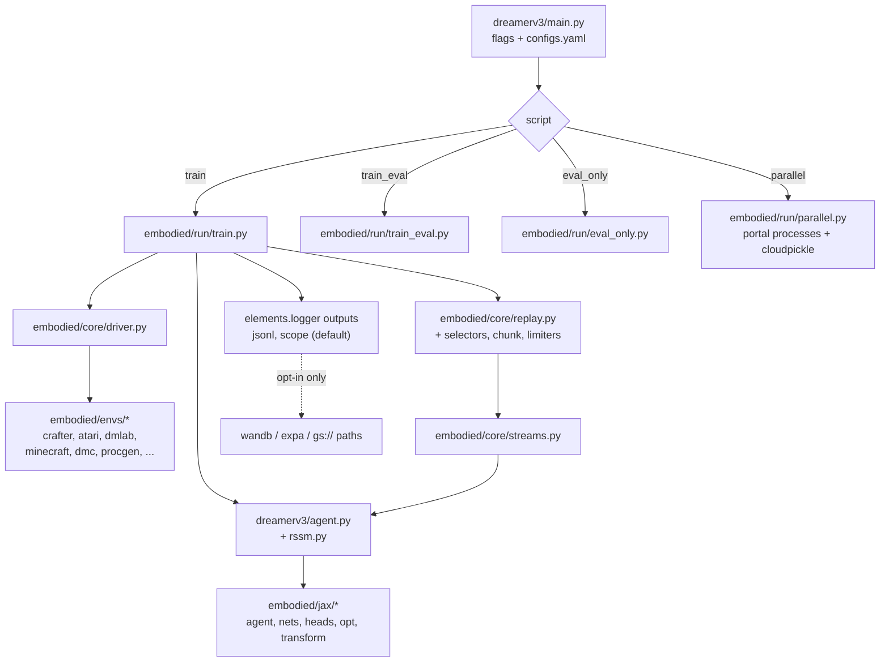

# OVERORDENT — Repository canonical audit V1

```text
REPOSITORY:   ktryk12/dreamerv3 (fork of danijar/dreamerv3)
CHECKOUT:     E:\repos\dreamerv3 (main checkout, not a worktree, no submodules)
AUDITED AT:   feat/podman-cpu-v1 @ 0e7332a0
UPSTREAM AT:  upstream/main @ e01491fa
DATE:         2026-10-22
MUTATIONS:    none to tracked content; this report is the only file written
              and it is left uncommitted for owner review
```

This record states what was measured. Where a thing was not measured it says
NOT_VERIFIED or UNKNOWN rather than inferring it.

---

## A. Executive summary

**Role.** This repository is a research reinforcement-learning codebase — a
reimplementation of DreamerV3 — forked so that container work for Podman can be
maintained without diverging from upstream. It is not an OVERORDENT component
today: it has no authority surface, no identity, no capability contract and no
integration point with Virkora (section J).

**Overall technical state.** The fork itself is in the cleanest possible git
condition. The upstream code it carries is sound in architecture but ships a
**broken test suite** and an **under-declared dependency set**, and this
Windows checkout introduces a **line-ending defect on the GPU container path**.

**Largest findings.**

1. No trustworthy test baseline: 55 failed / 141 passed, and 4 of 11 test
   modules cannot even be collected (F-1, F-2). All of it pre-exists our fork.
2. `entrypoint.sh` is CRLF in this working tree, so the upstream GPU
   `Dockerfile` built from this checkout produces an image whose entrypoint
   cannot run (E-1).
3. Several imported packages are not declared in `requirements.txt`, so a clean
   install cannot run `plot.py`, the parallel runner or the tests (I-2).

**Largest risk.** Not data loss and not security — it is that we are about to
modify a codebase whose own regression suite cannot tell us whether we broke
something.

**Recommended development baseline.** `feat/podman-cpu-v1 @ 0e7332a0`
(section H).

**Next concrete action.** Fix the test suite's dependency and API drift so a
real pass/fail baseline exists before any DreamerV3 code is modified (task 1 in
section I). It needs no owner GO.

---

## B. Git and history

### Remotes

```text
origin    https://github.com/ktryk12/dreamerv3.git   (our fork)
upstream  https://github.com/danijar/dreamerv3.git   (danijar)
```

### Mainline and branches

| Ref | SHA | Relation |
|---|---|---|
| `main` (local) | `e01491fa` | identical to `upstream/main`: 0 ahead, 0 behind |
| `origin/main` (GitHub) | `e01491fa` | same commit |
| `upstream/main` | `e01491fa` | tip after `git fetch --all` on 2026-10-22 |
| `feat/podman-cpu-v1` | `0e7332a0` | 2 ahead of `main`, 0 behind; merge-base `e01491fa` |
| `origin/feat/podman-cpu-v1` | `0e7332a0` | 0 ahead, 0 behind — fully pushed |

Tags: none. Worktrees: one (this checkout). Stashes: none. Detached HEADs: none.
Submodules: none. `git status --porcelain`: empty before this report was
written.

### Unpushed work

**None.** Every commit on every local ref exists on a remote. There is no
local-only work and nothing can be lost by cleanup, because there is nothing to
clean up.

### Our delta against upstream

```text
 .containerignore       |   9 ++++
 Containerfile.podman   |  54 +++++++++++++
 PODMAN.md              | 122 ++++++++++++++++++++++++++++++
 scripts/podman-cpu.ps1 |  96 ++++++++++++++++++++++
 4 files changed, 281 insertions(+)
```

Purely additive: four new files, zero upstream lines modified or deleted. This
is why none of the defects below can be attributed to our commits, and why
upstream merges stay trivial.

### Candidates

There is only one development line beyond upstream, so this section produces no
competing candidates to adjudicate. Section H records the baseline.

### Backup status

`VERIFIED` — by remote, not by a separate archive. Every ref is present on
`origin` (GitHub) and all upstream history is additionally on `upstream`. No
local-only objects exist, so no backup step was needed before the read-only
work in this audit.

---

## C. Architecture



### Components and boundaries

- **Entry point.** One: `dreamerv3/main.py`. `script` in the config selects the
  run loop. `python dreamerv3/main.py --logdir ... --configs ...`.
- **Agent/engine split.** `dreamerv3/` holds the algorithm (world model, actor
  critic, RSSM). `embodied/` holds reusable infrastructure (env API, replay,
  driver, streams, JAX plumbing, run loops). The contract between them is
  `embodied/core/base.py` (`Agent`, `Env`, `Stream`).
- **Dependencies point inward.** `embodied/core` imports no env and no agent;
  envs depend on `base.Env`; the agent depends on `embodied.jax`. No cycles
  found.
- **Persisted state.** Everything under `--logdir`: `metrics.jsonl`,
  `scores.jsonl`, `ckpt/`, replay chunks. No database, no global state outside
  the logdir.
- **External systems.** None required. Network use is opt-in: `wandb`/`expa`
  logger outputs, or a `gs://` / `/cns/` logdir handled by `elements`
  (`google-resumable-media` is a declared dependency). Default
  `logger.outputs: [jsonl, scope]` is local-only.
- **Process/network boundary.** Only `embodied/run/parallel.py`. It serializes
  factory functions with `cloudpickle` and spawns `portal` processes; default
  addresses are `localhost:{auto}` (loopback, auto-assigned port).
- **Data assets.** `scores/` (28 `.json.gz`, 6.1 MB) and `baselines.yaml` are
  published benchmark results consumed by `plot.py`. Read-only research data.

Code size: 10,360 lines of Python across 58 tracked `.py` files; 99 tracked
files total.

---

## D. Component status

| Component | Status | Evidence | Blocker | Next action |
|---|---|---|---|---|
| `dreamerv3/agent.py`, `rssm.py` | STABLE | published algorithm; trains on CPU in our image (2000 steps Crafter, losses decreasing) | — | none |
| `embodied/jax/*` | STABLE | exercised by every training step | couples to JAX version: `transform.py:56` uses positional `jax.jit` args, removed in JAX >= 0.5 | keep the pin; revisit when upstream moves |
| `embodied/core/replay.py` + selectors | STABLE in use / TESTS STALE | works in training; `test_replay.py` has 53 failures because tests call `replay.dataset()`, which the class no longer has (public API: `add`, `sample`, `update`, `stats`, `save`, `load`) | F-1 | port tests to current API |
| `embodied/core/driver.py` | STABLE in use / TESTS STALE | 2 failures, both `KeyError: 'reset'` (`test_driver.py:57`, `:110`) | F-1 | port tests |
| `embodied/run/train.py` | TESTED_NOT_RELEASED | verified end-to-end on Crafter CPU, exit 0 | — | — |
| `embodied/run/train_eval.py`, `eval_only.py` | UNKNOWN | never executed in this audit | — | run once on Crafter |
| `embodied/run/parallel.py` | UNKNOWN | never executed; its test module cannot be collected | F-2 | after F-2 |
| `embodied/envs/crafter.py` | STABLE | the environment used for the smoke test | — | — |
| `embodied/envs/{atari,dmlab,minecraft,procgen,dmc,loconav,bsuite}.py` | UNKNOWN | not installed in the CPU image, never run here | heavy/GPU deps | out of scope until needed |
| `embodied/tests/` | BLOCKED | 55 failed / 141 passed; `test_parallel.py` + `test_train.py` un-collectable | F-1, F-2 | tasks 1-2 |
| `embodied/perf/` (4 modules) | BLOCKED | all four import `zerofun`, which is not a declared dependency and not installed | F-2 | tasks 1-2 |
| `plot.py` | BLOCKED | imports `matplotlib`, `pandas`, `ruamel.yaml`; none are in `requirements.txt` | I-2 | declare deps |
| `scores/`, `baselines.yaml` | STABLE | static research data | — | — |
| `Dockerfile` (upstream GPU) | NOT_VERIFIED | never built in this environment; and see E-1 | E-1, GPU hardware | do not build from this checkout until E-1 is fixed |
| `entrypoint.sh` | BLOCKED | CRLF in the working tree (E-1) | E-1 | add `.gitattributes` |
| `Containerfile.podman`, `scripts/podman-cpu.ps1`, `PODMAN.md` | TESTED_NOT_RELEASED | build green; `podman-cpu.ps1 smoke` trains 2000 steps, exit 0; PR #1 open, unmerged | owner review of PR #1 | merge or request changes |

Nothing is classified SUPERSEDED.

---

## E. Security

Risk profile: a local research trainer. No credentials, no authority, no
multi-tenancy, no production effect. Findings are scaled to that.

### E-1 — CRLF entrypoint breaks the GPU image (P1)

`core.autocrlf=true` on this machine and the repository has **no
`.gitattributes`**, so `entrypoint.sh` is checked out with CRLF line
terminators:

```text
$ file entrypoint.sh
entrypoint.sh: ASCII text, with CRLF line terminators
$ od -c entrypoint.sh | head -1
0000000   s   e   t       -   e  \r  \n  ...
```

The upstream `Dockerfile` ends with `ENTRYPOINT ["sh", "entrypoint.sh"]` after
`COPY . .`, so an image built from this checkout carries a script whose every
line ends in `\r`. Under `sh` that is a runtime failure, not a warning.

Minimal safe fix: add a `.gitattributes` with `*.sh text eol=lf`. Verification:
`file entrypoint.sh` reports LF after a fresh checkout. This is a candidate to
send upstream.

Our CPU `Containerfile.podman` is unaffected — it deliberately does not use
`entrypoint.sh` and sets `CMD` directly.

### E-2 — Supply chain, upstream Dockerfile (P2, upstream-owned)

- `RUN wget -O - https://gist.githubusercontent.com/.../install-dmlab.sh | sh`
  — an unpinned remote script piped into a shell at build time.
- `pip install ale_py==0.9.0 autorom[accept-rom-license]==0.6.1` — accepts a
  licence and downloads Atari ROMs non-interactively.
- MineRL installed from a GitHub release URL.
- `FROM ghcr.io/nvidia/driver:7c5f8932-550.144.03-ubuntu24.04` — a tag, not a
  digest.

These are upstream's choices on a path we do not currently build. Recorded, not
fixed, because changing them diverges us from upstream for no present benefit.

### E-3 — Supply chain, our Containerfile (P2, ours)

- `FROM docker.io/library/python:3.11-slim` — tag, not digest.
- `RUN pip install crafter` — unpinned.

Both are cheap to pin and would make our builds reproducible.

### E-4 — Container runs as root (P2, ours)

```text
$ podman run --rm dreamerv3-cpu id -u
0
```

No `USER` directive. Upstream's `Dockerfile` hints at non-root intent
(`chown -R 1000:root`) but also never sets `USER`. For a local trainer with a
single named volume this is low impact; it is still the wrong default.

### E-5 — cloudpickle over portal RPC (P3, conditional)

`embodied/run/parallel.py:32-38` serializes factory functions with
`cloudpickle` and hands them to `portal` processes. Deserializing cloudpickle is
equivalent to executing code. Default addresses are `localhost:{auto}`
(`configs.yaml:61-63`), so there is no listener on a routable interface by
default. This only becomes a trust boundary if those addresses are ever changed
to a non-loopback interface for multi-node training — which is exactly what
section J would require if DreamerV3 were ever integrated.

### Safe-by-default assessment

Checked for unintended activation on import, startup, default deployment,
example config, test run and container restart:

- No `subprocess`, `os.system`, `eval(`, `exec(`, `pickle`, `requests`,
  `urllib` or `socket` anywhere in the Python sources (grep across all 58
  files; the only hits for "requests" are local variable names in
  `clock.py`/`streams.py`).
- Default logger outputs are local (`jsonl`, `scope`). `wandb` and `expa`
  require explicit opt-in via `logger.outputs`.
- Remote storage is reached only if the operator passes a `gs://` or `/cns/`
  logdir.
- The test run was executed with `--network none` and still completed, which
  demonstrates the suite opens no outbound connections.

Verdict: **safe-by-default holds.** Nothing becomes operational as a side
effect.

One note on the upstream `entrypoint.sh`: it queries the GCP metadata service
(`curl -H 'Metadata-Flavor: Google' http://metadata.google.internal/...`) on
every container start. Harmless off GCP (it fails and prints `NA`), but it is an
unconditional outbound attempt. Our CPU image does not run it.

---

## F. Tests

### Environment

Tests were run inside a container built on the audited image, with no network:

```text
image: dreamerv3-cpu-test = dreamerv3-cpu + pytest 8.3.4 + pytest-timeout 2.3.1

podman run --rm --network none dreamerv3-cpu-test bash -lc
  "cd /app; python -m pytest embodied/tests -q -p no:cacheprovider"
```

Imports resolve from `/app` inside the image, which is `COPY . .` of this
checkout — verified by the image build log. No host path is mounted, so no
production or host data is reachable.

### Results

```text
embodied/tests, excluding the 2 un-collectable modules:

  141 passed
   55 failed
    0 skipped

  failures by module:
     53  embodied/tests/test_replay.py
      2  embodied/tests/test_driver.py

collection errors (the whole suite aborts without --ignore):

  embodied/tests/test_parallel.py   ModuleNotFoundError: No module named 'zerofun'
  embodied/tests/test_train.py      same, via embodied/tests/utils.py:4
```

Reproducible: two consecutive runs gave identical totals (14.84 s, 17.15 s).

### F-1 — Tests assert a removed API (P1, pre-existing)

`test_replay.py` and `embodied/perf/test_replay.py` call `replay.dataset(1)`.
`Replay`'s public methods are `stats`, `add`, `sample`, `update`, `save`,
`load` — there is no `dataset`. Representative failure:

```text
embodied/tests/test_replay.py:344: AssertionError
  assert stats['samples'] > 0  ->  assert 0 > 0
cause: AttributeError: 'Replay' object has no attribute 'dataset'
       (raised in a worker thread, surfacing as a zero-sample assertion)
```

`test_driver.py` fails twice with `KeyError: 'reset'` at `:57` and `:110` — the
same class of defect against the driver/env action contract.

### F-2 — Tests import a renamed dependency (P1, pre-existing)

Production code imports `portal` (`main.py`, `core/clock.py`, `core/driver.py`,
`core/streams.py`, `run/parallel.py`) and `requirements.txt` declares
`portal>=3.5.0`. Test and perf code still imports `zerofun`, the package's
former name: `embodied/tests/test_parallel.py:8`, `embodied/tests/utils.py:4`,
and all four `embodied/perf/*` modules. `zerofun` is declared nowhere.

### Attribution

Both defects are upstream's. Our two commits add four files and modify no
Python, so the 55 failures and 4 un-collectable modules exist identically at
`upstream/main @ e01491fa`. **NOT_VERIFIED:** we did not re-run the suite at
`e01491fa` to prove this by execution; it follows from the diff being purely
additive.

### Coverage gaps

No coverage was measured. By inspection there is no test for the agent itself
(`dreamerv3/agent.py`, `rssm.py`), none for `embodied/jax/*`, and none for any
environment adapter. The suite covers replay, selectors, driver, layer scan and
the train loop — and of those, replay and driver are the two that fail.

No assertion was modified, no `xfail` was added and nothing was skipped to
produce a greener number.

---

## G. Governance

Upstream `danijar/dreamerv3` carries no phase manifests, frozen specifications,
owner decisions, HOLD/STOP records, approval records, security gates or release
conditions. There is no CI: **no `.github/` directory exists**. There are no
tags and no GitHub releases. Governance is "the maintainer merges PRs".

Our fork's governance, as practised so far:

| Instrument | State |
|---|---|
| Branch protection | none configured |
| Review | PR #1 (https://github.com/ktryk12/dreamerv3/pull/1), open, unmerged |
| Release conditions | none defined |
| Historical FAIL/INCONCLUSIVE records | none exist to preserve |
| Owner decisions | none recorded in-repo |

No historical result was rewritten by this audit, because there were none.

Status distinctions for the work in PR #1:

```text
technically implemented   YES      (build + smoke verified)
tested                    PARTIAL  (our layer verified; upstream suite red)
governance approved       NO       (PR #1 unmerged)
release approved          NO       (no release process exists)
production activated      NO       (not applicable)
```

---

## H. Canonical baseline

```text
RECOMMENDED SHA:           0e7332a040e83fe694d1e842c7e9bf7b6fbf60bf
BRANCH:                    feat/podman-cpu-v1
development/canonical-v1:  NOT CREATED — deliberately
```

**Rationale.** `main` equals `upstream/main` exactly and carries no Podman
support, so it is the release base but not the development base.
`feat/podman-cpu-v1` is `main` plus two additive commits, is fully pushed, has
no divergence from its remote, and is the only commit at which the CPU workflow
is known to build and train. There is no competing development line to
adjudicate.

**Why no new branch.** Gate J asks for an isolated `development/canonical-v1`
when one unambiguous candidate exists. Here that candidate is already a named,
pushed branch with an open PR. A third ref pointing at the same commit would add
a "which branch do I work on?" question rather than remove one, which is the
opposite of that gate's purpose. Creating it is one command if the owner
prefers the literal form.

**What is not included.** Nothing. We are at upstream tip, and there is no
unmerged work anywhere in the fork.

**Test status at this baseline.** 141 passed / 55 failed / 4 modules
un-collectable (section F) — all pre-existing. Our own layer: build green,
smoke green.

**Current blockers against calling it a trustworthy baseline.** F-1 and F-2.
The code works; its regression suite does not.

---

## I. Consolidation plan

| # | Pri | Task | Scope | Effect | Evidence | Verification | Depends | Owner GO |
|---|---|---|---|---|---|---|---|---|
| 1 | P1 | Replace `zerofun` with `portal` in the 6 test/perf modules | `embodied/tests/{utils,test_parallel}.py`, `embodied/perf/*` | makes 2 modules collectable; unblocks any real baseline | F-2 | suite collects with no `--ignore` | — | no |
| 2 | P1 | Port `test_replay.py` and `test_driver.py` to the current API | 2 test files | turns 55 unexplained failures into a real pass/fail signal | F-1 | suite green, or every remaining failure named with a cause | 1 | no |
| 3 | P1 | Add `.gitattributes` with `*.sh text eol=lf` | 1 new file | makes the upstream GPU image buildable from a Windows checkout | E-1 | `file entrypoint.sh` says LF | — | no |
| 4 | P1 | Declare the undeclared dependencies | `requirements.txt` or a new `requirements-dev.txt` | a clean install can run tests, `plot.py` and the parallel runner | I-2 | fresh venv runs all three | 1 | no |
| 5 | P2 | Pin our image inputs: base image by digest, `crafter==1.8.3` | `Containerfile.podman` | reproducible builds | E-3 | rebuild yields the same package set | — | no |
| 6 | P2 | Run as non-root in our image | `Containerfile.podman` | least privilege | E-4 | `id -u` is non-zero; smoke still green | — | no |
| 7 | P2 | Fold `.dockerignore` and `.containerignore` into one source | 2 files | removes a drift pair | I-3 | both builds see the same context | — | no |
| 8 | P2 | Merge PR #1 | — | the Podman workflow becomes our `main` | section G | `main` contains `0e7332a0` | owner review | **yes** |
| 9 | P3 | Minimal CI: build the CPU image, run the suite | `.github/workflows/` | the baseline stops regressing silently | section G | a green run on a PR | 1, 2 | no |
| 10 | P3 | Send tasks 1-3 upstream as a PR to `danijar/dreamerv3` | — | our fork shrinks; upstream gets the fixes | F-1, F-2, E-1 | upstream PR opened | 1, 2, 3 | **yes** |

### I-2 — Undeclared dependencies (P1)

Imported but absent from `requirements.txt`:

| Package | Imported by | Currently works because |
|---|---|---|
| `cloudpickle` | `embodied/run/parallel.py:6` | installed transitively (3.1.2 present) |
| `zerofun` | 6 test/perf modules | it does not — see F-2 |
| `matplotlib`, `pandas`, `ruamel.yaml` | `plot.py` | not installed; `plot.py` cannot run |
| `crafter` | `embodied/envs/crafter.py` | our `Containerfile.podman` installs it explicitly |
| `pytest` | the whole suite | there is no declared test dependency at all |

`pip check` inside the audited image reports `No broken requirements found`, so
the pinned set we build is internally consistent — the gap is between what the
code imports and what the manifest declares.

### I-3 — Other technical debt

- Two ignore files (`.dockerignore`, `.containerignore`) with different
  contents; they will drift. P2.
- `Dockerfile` installs `jax[cuda]==0.5.0` while `requirements.txt` pins
  `jax[cuda12]==0.4.33`, so the later `pip install -r requirements.txt`
  downgrades it, and `chex`/`optax` are unpinned. That is the same conflict we
  hit and pinned around on CPU. Whether the GPU image is affected is
  **NOT_VERIFIED** — we have never built it. P2.
- Image size 1.72 GB for a CPU trainer. P3.
- No type checking, no linter config, no formatter config. P3 — upstream's
  choice, not a defect.

---

## J. OVERORDENT integration

```text
OVERORDENT INTEGRATION: OUT_OF_SCOPE
```

Measured, not assumed:

- `grep -rni dreamer` across the Virkora working copy
  (`E:\repos\babyAI\babyAI`, a checkout of `ktryk12/Virkora`): **zero
  matches.** No capability contract, no tool definition, no adapter, no OVI
  identity and no Foundation capability mapping exists for this repository.
- `embodied/envs/` contains no Virkora adapter, and this repository defines no
  observation or action space over orchestrator state.
- Virkora's own target contract gates the coupling:
  `docs/architecture/VIRKORA_AGENT_ORCHESTRATION_WORLD_MODEL_V1_2.md` section 21
  lists `Fixed eval/learning framework | MISSING | after repeatable E2E
  episodes`, and LAW 4 ("Learning != Authority") plus LAW 5 forbid evaluating
  authority from `PREDICTED` state. Section 20 requires an `ExperienceRecord`, a
  fixed eval suite, shadow mode, drift measurement and deterministic rollback
  before learned routing — none of which are built.

Under READ / ANALYZE / EFFECT this repository would be **ANALYZE at most**: it
consumes experience and emits predictions. It has no effect surface and must
never acquire one. If integration is ever authorized, the two boundaries to
design first are E-5 (cloudpickle over RPC must not cross a trust boundary) and
a one-way data contract from Virkora's `ExperienceRecord` into an
`embodied.Env` adapter.

No integration step is proposed here, and none is implied by this repository
being present in the OVERORDENT constellation.

---

## K. Release path

The repository has no release process. A proportionate one — objective checks,
no ceremony:

| Stage | Gate | Evidence required |
|---|---|---|
| 1. Development baseline | `feat/podman-cpu-v1` | section H |
| 2. Release candidate | suite collects and its result is explained; CPU image builds; smoke trains | tasks 1-2, `podman-cpu.ps1 build` + `smoke` |
| 3. Mainline merge | PR reviewed; diff against upstream still purely additive | `git diff --stat upstream/main..` |
| 4. Publication | pushed to `origin/main` | — |
| 5. Deployment | not applicable — this is a local trainer | — |
| 6. Monitoring | not applicable | — |
| 7. Rollback | `main` equals `upstream/main`, so reverting is a branch reset to `e01491fa` | — |

Stages 5 and 6 stay empty on purpose. Inventing them for a research trainer
would be bureaucracy, not risk reduction.

---

## L. Final verdict

```text
GIT HISTORY:             PRESERVED
BACKUP:                  VERIFIED     (by remote; no local-only objects exist)
CANONICAL BASELINE:      IDENTIFIED   (0e7332a0, feat/podman-cpu-v1)
DEVELOPMENT BRANCH:      NOT_CREATED  (justified in section H)
ARCHITECTURE:            SOUND
SECURITY:                PARTIAL      (E-1 is P1; E-2/E-3/E-4 are P2)
GOVERNANCE:              PARTIAL      (no CI, no release process, PR #1 open)
TEST BASELINE:           FAIL         (55 failed / 141 passed / 4 un-collectable)
OVERORDENT INTEGRATION:  OUT_OF_SCOPE
READY FOR DEVELOPMENT:   CONDITIONAL  (on tasks 1-2)
READY FOR MAIN MERGE:    YES          (PR #1; additive and verified)
READY FOR PRODUCTION:    NO           (not a production artifact)
OVERALL:                 CONDITIONAL
```

---

## M. Closing answers

**1. Which codebase should we develop on.**
`feat/podman-cpu-v1 @ 0e7332a0`. It is upstream tip plus our four additive
files, fully pushed, and the only state where the CPU workflow is proven.

**2. What concretely blocks it.**
Not git and not architecture — the test suite. 55 failures against an API the
code no longer has, and 4 modules that cannot be imported because they
reference a package that was renamed. Until that is fixed we cannot tell a
regression from a pre-existing failure, which matters the moment we touch the
code.

**3. The three highest-value actions.**
Fix the `zerofun` to `portal` drift (task 1); port the replay and driver tests
to the current API (task 2); add `.gitattributes` so the GPU image is buildable
from a Windows checkout (task 3). Together they convert this from "code that
appears to work" into "code with a baseline".

**4. What can be done within existing authorization.**
Tasks 1-7 and 9. All are local, additive or test-only, need no new production
dependency, and change no authority, credential, identity or network boundary.

**5. What needs the owner's next GO.**
Merging PR #1 into `main` (task 8), and opening an upstream PR to
`danijar/dreamerv3` (task 10) — that one publishes our work under the owner's
GitHub identity. Any Virkora integration remains a separate decision and is not
requested here.
